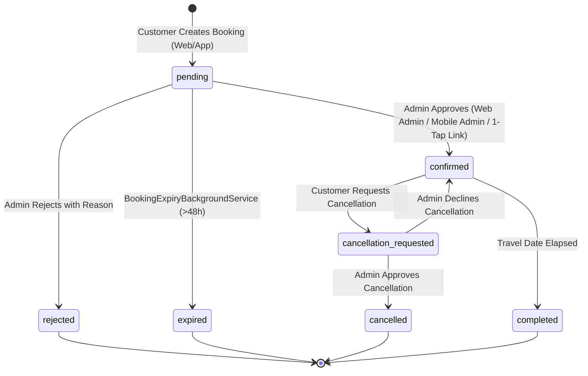

# Multi-Tenant Booking Confirmation & Status Lifecycle Runbook

A complete reference guide for the multi-tenant Booking Confirmation, Status Lifecycle, Outbox Emailing, and Admin Decision System across **GujjuTours**, **TripGoAsia**, and **Technoheaven**.

---

## 1. System Architecture & Multi-Tenant Isolation

The platform consists of a single backend supporting multiple branded websites and mobile apps, with strict multi-tenant database isolation at the MongoDB Atlas layer.

```
                              ┌────────────────────────────────────────┐
                              │  HTTP Request (Web / Mobile / Action) │
                              └───────────────────┬────────────────────┘
                                                  │ Header: X-Website-Hostname
                                                  ▼
                              ┌────────────────────────────────────────┐
                              │       WebsiteContextMiddleware         │
                              │        (WebsiteRegistry.cs)            │
                              └───────────────────┬────────────────────┘
                                                  │
                 ┌────────────────────────────────┼────────────────────────────────┐
                 ▼                                ▼                                ▼
   Hostname: gujjutours.com        Hostname: tripgoasia.com        Hostname: technoheaven.com
   Database: tours_gujjutours      Database: tours_tripgoasia      Database: tours_technoheaven
   Prefix:   GT-2026-XXXXXX        Prefix:   TGA-2026-XXXXXX       Prefix:   TH-2026-XXXXXX
   Brand:    Gujju Tours           Brand:    TripGo Asia           Brand:    Technoheaven
```

### Domain-to-Database Mapping Matrix

| Tenant Brand | Canonical Hostname | MongoDB Database | Booking Ref Prefix | Brand Theme Color | Currency | Default Expiry |
| :--- | :--- | :--- | :--- | :--- | :--- | :--- |
| **Gujju Tours** | `www.gujjutours.com` | `tours_gujjutours` | `GT-` | `#2563eb` (Blue) | USD ($) / INR (₹) | 48 Hours |
| **TripGo Asia** | `www.tripgoasia.com` | `tours_tripgoasia` | `TGA-` | `#16a34a` (Green) | USD ($) | 48 Hours |
| **Technoheaven** | `stagingb2b.technoheaven.com` | `tours_technoheaven` | `TH-` | `#dc2626` (Red) | USD ($) / AED (د.إ) | 48 Hours |

> [!IMPORTANT]
> **Strict Isolation Guarantee**: Bookings, users, authentication JWTs, and email outboxes are stored exclusively in each tenant's dedicated database. Querying or authenticating against a tenant with credentials or references from another tenant returns an immediate `404 Not Found` or `401 Unauthorized`.

---

## 2. Booking Lifecycle State Machine

Every booking created from Web (`source: "web"`) or Mobile (`source: "app"`) starts in the `pending` state and progresses through explicit, audited state transitions:



### Valid Status Values

| Status | Customer Experience | Admin View | Action Allowed |
| :--- | :--- | :--- | :--- |
| `pending` | "Booking Received — Concierge Review Pending". QR pass is locked. | Visible in Admin Inbox (Pending tab). | Admin can Approve or Reject. Expiry timer active. |
| `confirmed` | "Booking Confirmed — Voucher Ready". Live QR pass unlocked. | Visible in Confirmed tab. | Admin can view details. Customer can request cancellation. |
| `rejected` | "Booking Rejected — Reason Displayed". Full explanation provided. | Visible in Rejected tab with rejection reason. | Terminal state. Outbox notification sent. |
| `expired` | "Booking Expired — Time Limit Exceeded". | Visible in Expired tab. | Terminal state. Auto-triggered after 48h. |
| `cancelled` | "Booking Cancelled — Refund/Resolution Notes Shown". | Visible in Cancelled tab. | Terminal state. Cancellation audit entry appended. |
| `completed` | "Trip Completed — Review & Memories". | Visible in Completed tab. | Archived past booking. |

### Audit Trail (`statusHistory`)

Every status change appends a structured audit record to `booking.statusHistory`:

```json
{
  "fromStatus": "pending",
  "toStatus": "confirmed",
  "changedAt": "2026-10-27T09:15:21.085Z",
  "changedBy": "admin",
  "actorId": "6acf1eb9ce57eb1bd2a2089c",
  "reason": "Confirmed via admin inbox quick action",
  "metadata": {
    "source": "web_admin",
    "ip": "127.0.0.1"
  }
}
```

---

## 3. Decision Channels for Administrators

Administrators have three distinct channels to approve or reject bookings:

### Channel 1: Web Admin Portal (`/admin/bookings`)
- Real-time inbox summary counter badges (`Pending`, `Confirmed`, `Cancellation Requests`, `Rejected`, `Total`).
- Quick 1-tap **Approve** button with instant UI cache invalidation.
- **Reject** modal requiring a mandatory customer-facing explanation.
- **Cancellation Review** modal displaying customer reason, requested timestamp, and optional admin note.
- Full outbox email inspector drawer with **Resend Email** trigger.

### Channel 2: Mobile Admin Portal (`my-app/app/(admin)/bookings.tsx`)
- Native React Native executive inbox screen built for tablet & smartphone.
- Filter chips with badge counts.
- Swipeable card actions for Approve / Reject.
- Dedicated Cancellation Request banner with 1-tap Review modal.

### Channel 3: 1-Tap Signed Action Token Links (`/booking-action/[action]`)
When a booking is created, the system generates cryptographically signed HMAC-SHA256 action tokens embedded in the admin alert emails:
- **Approve Link**: `https://{webUrl}/booking-action/approve?token={HMAC_TOKEN}`
- **Reject Link**: `https://{webUrl}/booking-action/reject?token={HMAC_TOKEN}`

#### Anti-Scanner Prefetch Protection
- Mail clients (Outlook SafeLinks, Gmail link prefetchers) issue `GET` requests to preview links.
- The `/booking-action/[action]` page performs a safe, read-only `GET /api/bookings/action-token/verify?token=...` request to show booking details.
- State mutation strictly occurs only when the administrator explicitly clicks the confirmation button, sending a `POST /api/bookings/action-token/execute`.
- **Single-Use Replay Protection**: Tokens are recorded in `booking.usedActionTokens`. Replaying an already-used token returns an error message: `"This decision link has already been used and cannot be reused."`

---

## 4. Customer Experience & Gated E-Ticket Pass

### Customer Booking Confirmation Page (`/booking/confirmation?ref={REF}`)
- **Pending State**: Displays a 3-step progress stepper (*1. Reservation Placed* -> *2. Concierge Verification* -> *3. Confirmed & Voucher Ready*). The QR pass is locked with a badge: *"QR Voucher activates upon concierge approval"*.
- **Confirmed State**: Unlocks the official boarding pass, live animated QR code (`GT-{REF}-{TIMESTAMP}`), calendar sync button (`.ics`), and PDF print trigger.
- **Cancellation Request**: Customer can open the cancellation modal, input their reason, and submit. The booking displays a pending cancellation banner while preserving their confirmed reservation until reviewed.

### Customer Mobile Pass (`my-app/app/booking/[id].tsx`)
- Dynamic status banner matching brand color tokens.
- Native QR Code generator (`react-native-qrcode-svg`) rendered only when status is `confirmed`.
- State transition audit timeline visualizer.
- Native Cancellation Request modal with cancellation policy terms.

---

## 5. Reliable Email Delivery & Transactional Outbox

Email notifications are dispatched using the **Transactional Outbox Pattern** to ensure zero lost emails and non-blocking API performance.

```
┌─────────────────────────────────┐
│     Booking State Transition    │
└────────────────┬────────────────┘
                 │ 1. Transactionally enqueues email in same DB
                 ▼
┌─────────────────────────────────┐
│       email_outbox Collection   │ (Status: Queued, Attempts: 0)
└────────────────┬────────────────┘
                 │
                 │ 2. Background daemon polls every 5 seconds
                 ▼
┌─────────────────────────────────┐
│  EmailOutboxBackgroundService   │
└────────────────┬────────────────┘
                 │
                 ├──▶ In Development: DevFileEmailSender (Saves HTML to disk)
                 ├──▶ With SMTP:      SmtpEmailSender (SSL/TLS SMTP server)
                 └──▶ With SendGrid:  SendGridEmailSender (HTTP API v3)
```

### Outbox Email Templates

| Template Key | Recipient | Trigger Event | Includes |
| :--- | :--- | :--- | :--- |
| `customer_booking_received` | Customer | Booking created (`pending`) | Order details, reference, concierge review message. |
| `admin_new_booking_alert` | Admin Operations | Booking created (`pending`) | Guest info, total price, 1-tap Approve & Reject buttons. |
| `customer_booking_confirmed` | Customer | Booking approved (`confirmed`) | Boarding pass details, meeting instructions, view pass link. |
| `customer_booking_rejected` | Customer | Booking rejected (`rejected`) | Rejection reason, support contacts, alternative tours. |
| `customer_booking_cancelled` | Customer | Booking cancelled (`cancelled`) | Refund status, admin resolution note. |
| `customer_booking_expired` | Customer | Booking expired (`expired`) | Expired notification, quick rebook link. |
| `admin_cancellation_request_alert` | Admin Operations | Cancellation requested | Customer reason, booking reference, review link. |

### Development Email Inspection (`DevFileEmailSender`)
In development mode (`"Email": { "Provider": "Dev" }`), emails are rendered to disk as complete HTML files:
```
backend/toursApi/bin/Debug/net8.0/dev-emails/{TIMESTAMP}_{TENANT}_{RECIPIENT}_{SUBJECT}.html
```
Open any of these HTML files directly in your web browser to visually inspect the exact email sent to the customer or administrator.

---

## 6. Background Daemons

Two hosted background workers run inside ASP.NET Core:

### 1. `BookingExpiryBackgroundService`
- **Interval**: Runs every 15 minutes.
- **Function**: Queries all bookings across all databases where `status == "pending"` and `createdAt < (Now - PendingExpiryHours)` (default: 48h).
- **Action**: Marks booking as `expired`, appends an audit record to `statusHistory`, and enqueues `customer_booking_expired` in the outbox.

### 2. `EmailOutboxBackgroundService`
- **Interval**: Runs every 5 seconds.
- **Function**: Queries pending emails where `status in ("Queued", "Processing")` and `nextAttemptAt <= UtcNow`.
- **Retry Logic**: Exponential backoff (15s, 60s, 5m, 15m, 1h) up to 5 attempts before marking as `Failed`.

---

## 7. REST API Reference

All requests must include the `X-Website-Hostname` header to resolve the target website database.

### 1. Create Booking
- **Route**: `POST /api/bookings`
- **Auth**: Public or Customer JWT
- **Body**:
  ```json
  {
    "tourId": 101,
    "tourName": "Dubai Desert Safari",
    "guestName": "Aarav Patel",
    "email": "aarav.patel@example.com",
    "phone": "+91 98765 43210",
    "date": "2026-12-05",
    "travelers": 2,
    "totalPrice": 598.00,
    "source": "web"
  }
  ```
- **Response**: `201 Created` with booking entity (`status: "pending"`).

### 2. Admin Inbox Counts
- **Route**: `GET /api/bookings/inbox/counts`
- **Auth**: Admin JWT (`Bearer <token>`)
- **Response**:
  ```json
  {
    "success": true,
    "data": {
      "pending": 3,
      "confirmed": 14,
      "cancellationRequests": 1,
      "rejected": 2,
      "expired": 0,
      "completed": 28,
      "total": 48
    }
  }
  ```

### 3. Admin Confirm Booking
- **Route**: `POST /api/bookings/{id}/confirm`
- **Auth**: Admin JWT
- **Body**: `{ "note": "Verified payment and tour guide availability." }`
- **Response**: `200 OK` with updated booking entity (`status: "confirmed"`).

### 4. Admin Reject Booking
- **Route**: `POST /api/bookings/{id}/reject`
- **Auth**: Admin JWT
- **Body**: `{ "reason": "Tour fully booked by private charter." }`
- **Response**: `200 OK` with updated booking entity (`status: "rejected"`).

### 5. Verify Signed Action Token (Read-Only)
- **Route**: `GET /api/bookings/action-token/verify?token={TOKEN}`
- **Auth**: None (Protected by token HMAC signature)
- **Response**:
  ```json
  {
    "valid": true,
    "action": "reject",
    "bookingId": "6ae06c...",
    "bookingReference": "TGA-2026-CZQT4X",
    "guestName": "Mei Ling",
    "totalPrice": 240.00,
    "currency": "$"
  }
  ```

### 6. Execute Signed Action Token (Mutating)
- **Route**: `POST /api/bookings/action-token/execute`
- **Auth**: None (Protected by token HMAC signature & single-use check)
- **Body**:
  ```json
  {
    "token": "{HMAC_TOKEN}",
    "action": "reject",
    "reason": "Capacity reached for selected date"
  }
  ```
- **Response**: `200 OK` with `{ "success": true, "data": { ... } }`.

### 7. Customer Request Cancellation
- **Route**: `POST /api/bookings/{id}/request-cancellation`
- **Auth**: Customer JWT or email verification
- **Body**:
  ```json
  {
    "reason": "Medical emergency in family",
    "email": "aarav.patel@example.com"
  }
  ```
- **Response**: `200 OK` with booking entity (`cancellationRequest.status: "pending"`).

### 8. Admin Review Cancellation
- **Route**: `POST /api/bookings/{id}/review-cancellation`
- **Auth**: Admin JWT
- **Body**:
  ```json
  {
    "approve": true,
    "adminNote": "Full refund issued per emergency policy."
  }
  ```
- **Response**: `200 OK` with booking entity (`status: "cancelled"`).

### 9. Booking Outbox Audit
- **Route**: `GET /api/bookings/{id}/outbox`
- **Auth**: Admin JWT
- **Response**: `200 OK` with list of dispatched emails for this booking.

---

## 8. Verification & Test Checklist

### Automated E2E Test Execution
Run the full 6-stage multi-tenant verification script:

```powershell
powershell -ExecutionPolicy Bypass -File "C:\Users\Charmi\.gemini\antigravity-ide\brain\f15fd8f1-3df8-43f2-8fc9-42b126fa4fc0\scratch\test_phase5_e2e_multitenant.ps1"
```

Expected output:
```
=================================================================
PHASE 5: MULTI-TENANT END-TO-END E2E WORKFLOW VERIFICATION
=================================================================
>>> [STAGE 1] Admin Authentication for all 3 Tenants: PASS
>>> [STAGE 2] GujjuTours: Web Booking Creation -> Pending -> Admin Confirm: PASS
>>> [STAGE 3] TripGoAsia: App Booking Creation -> Signed Action Token Rejection: PASS
>>> [STAGE 4] Technoheaven: Web Booking -> Confirm -> Cancellation Request -> Admin Review: PASS
>>> [STAGE 5] Multi-Tenant Database Isolation Matrix: PASS
>>> [STAGE 6] Email Outbox Audit across Tenants: PASS
=================================================================
PHASE 5 VERIFICATION RESULT: 100% SUCCESS ACROSS ALL 3 TENANTS!
=================================================================
```

### Manual Testing Scenarios

#### Scenario A: Web Booking & Email Link Decision
1. Open web app at `http://localhost:3000` (ensure `SITE_ID=tripgoasia`).
2. Complete a tour reservation. Notice the confirmation page shows **Pending Concierge Review** with a locked QR code.
3. Open `backend/toursApi/bin/Debug/net8.0/dev-emails/` and find the latest `admin_new_booking_alert` HTML file.
4. Click the green **Approve & Confirm** button in the email.
5. In the opened `/booking-action/approve` page, review the booking and click **Confirm Reservation**.
6. Refresh the customer confirmation page. Verify the status updates to **Confirmed** and the live QR pass unlocks!

#### Scenario B: Mobile App Booking & Mobile Admin Inbox
1. Open Expo app in simulator or Expo Go (`npx expo start`).
2. Make a booking from the mobile tour details screen.
3. Switch to the **Bookings** tab. Verify the booking appears under the **Pending** segment.
4. Tap the booking. Verify the 3-step timeline is displayed and the QR pass shows "Pending Concierge Review".
5. Log in to the Mobile Admin portal (`(admin)/bookings`).
6. Tap the **Approve** button on the booking card.
7. Return to the customer Bookings tab. Verify the booking is now under **Confirmed** with an active QR code!

#### Scenario C: Customer Cancellation Request & Admin Approval
1. Open any confirmed booking in Mobile or Web.
2. Click **Request Cancellation**.
3. Enter a cancellation reason (e.g. "Flight schedule change") and submit.
4. In Web Admin (`/admin/bookings`) or Mobile Admin, verify the **Cancellation Requests** count badge increases by 1.
5. Open the cancellation review modal, enter a refund note, and click **Approve Cancellation**.
6. Verify the booking status transitions to **Cancelled** and a confirmation email is dispatched.
