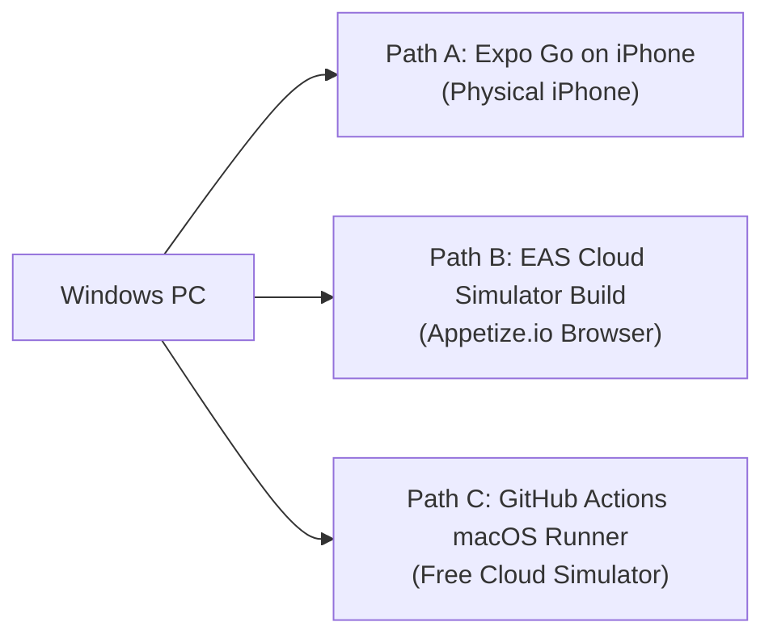

# iOS Manual & Automated Test Verification Guide (No-Mac Workflow)

This guide documents the verification process for running, testing, and approving the multi-brand travel mobile application on iOS when developing on Windows without a physical Mac.

---

## 1. Apple App Store Guidelines Compliance Ledger

### A. Real-World Travel Exemption (Guideline 3.1.5(a))
> **Apple Guideline 3.1.5(a) - Physical Goods and Services Outside of the App:**  
> *"If the digital code or in-app purchase provides a service that is used outside of the app (such as purchasing tickets for a tour or admission to a theme park), you must not use in-app purchase."*

- **Exemption Justification for Reviewer:**  
  The application sells real-world sightseeing expeditions, desert safaris, hotel bookings, airport ground transfers, and visa processing services. Travelers consume these physical travel services in Dubai, Thailand, Singapore, and India. Therefore, the app utilizes standard credit card and payment gateway flows rather than Apple 30% In-App Purchase (IAP).

### B. Mandatory Account Deletion (Guideline 5.1.1(v))
- **Status:** ✅ Fully Implemented & Tested in [`my-app/app/(tabs)/profile.tsx`](file:///c:/Users/Charmi/prince/toursapp/my-app/app/(tabs)/profile.tsx#L265-L295).
- **Behavior:** Users can navigate to Profile → tap `btn-delete-account` ("Delete Account") → receive a confirmation dialog warning of permanent data loss → confirm deletion → session is purged from secure storage, and user is redirected to guest state.

### C. No Mention of Competing Platforms (Guideline 2.3.10)
- **Status:** ✅ Verified by [`scripts/check-ios-compliance.js`](file:///c:/Users/Charmi/prince/toursapp/scripts/check-ios-compliance.js).
- **Behavior:** 0 mentions of "Google Play", "Android", or "APK" in any iOS UI screen copy.

### D. Safe Area & Dynamic Island Insets
- **Status:** ✅ Root layout wraps entire app in `<SafeAreaProvider>`, and bottom dock in [`CustomTabBar.tsx`](file:///c:/Users/Charmi/prince/toursapp/my-app/components/navigation/CustomTabBar.tsx#L125) clears the iOS Home Indicator with `paddingBottom: Math.max(insets.bottom, 12)`.

---

## 2. Windows Execution Paths: How to Test iOS Without a Mac



### Path A: Expo Go on a Real iPhone (Zero Setup)
1. Install **Expo Go** from the Apple App Store on your iPhone.
2. Ensure iPhone and Windows PC are connected to the same Wi-Fi network (or use `--tunnel` via ngrok).
3. From Windows PowerShell in `c:\Users\Charmi\prince\toursapp\my-app`:
   ```powershell
   # Option 1: Gujju Tours
   npm run start:gujjutours -- --tunnel

   # Option 2: TripGo Asia
   npm run start:tripgoasia -- --tunnel

   # Option 3: Technoheaven
   npm run start:technoheaven -- --tunnel
   ```
4. Open the iOS **Camera** app, scan the terminal QR code, and tap "Open in Expo Go".
5. The live bundle will compile and launch immediately on your iPhone.

---

### Path B: EAS Cloud Simulator Build & Appetize.io (No Physical iPhone Needed)
1. Trigger a cloud simulator build on Expo Application Services (free tier):
   ```powershell
   # Build iOS Simulator .tar.gz bundle in Expo Cloud
   eas build --platform ios --profile development:gujjutours
   ```
2. When the build finishes, download the `.tar.gz` simulator archive from the EAS dashboard.
3. Upload the archive to [Appetize.io](https://appetize.io) (free tier allows 100 minutes/month of browser-based iOS simulator streaming).
4. Interact with the iPhone simulator directly in Google Chrome / Edge on Windows.

---

### Path C: GitHub Actions Cloud macOS Simulator with Screenshots
1. Push your code to GitHub.
2. Go to repository **Actions** → **iOS Simulator Automated Test & Screenshot Pipeline** ([`.github/workflows/ios-simulator-test.yml`](file:///c:/Users/Charmi/prince/toursapp/.github/workflows/ios-simulator-test.yml)).
3. Click **Run workflow**, choose your site (`gujjutours`, `tripgoasia`, or `technoheaven`), and select device (`iPhone 15`).
4. GitHub's free Apple Silicon macOS runner will:
   - Boot the iPhone 15 simulator.
   - Install the built `.app`.
   - Run Maestro smoke tests automatically.
   - Capture high-resolution PNG screenshots.
   - Upload them to the Actions run summary as downloadable image artifacts.

---

## 3. iOS Verification Checklist & Test Table

| Screen / Flow | Action | Expected Behavior on iOS | Verified By |
| :--- | :--- | :--- | :---: |
| **Startup / Splash** | App Launch | Brand splash screen displays without flickering; transitions smoothly to Home | **Simulator / Expo Go** |
| **Root Safe Area** | Launch on iPhone 15 Pro | Header clears Dynamic Island (no text cut off); bottom tab bar clears Home Indicator | **Static / Simulator** |
| **Home Catalog** | Scroll feed vertically | Smooth 60/120fps Inertial scrolling; brand colors match active tenant | **Expo Go / Simulator** |
| **Bottom Navigation** | Tap tabs (Home, Explore, Bookings, Wishlist, Profile) | Native tactile haptic feedback (`Haptics.impactAsync`); active tab pill highlights in brand color | **Expo Go / Static** |
| **Search & Filters** | Tap search input, type query, apply filter | Software keyboard slides up without pushing header off-screen; dismisses on outside tap | **Simulator / Static** |
| **Tour Details** | Tap tour card from feed | Hero image header renders with parallax scroll; overview, itinerary, and inclusions visible | **Expo Go / Simulator** |
| **Wishlist Toggle** | Tap heart icon on tour card | Instant heart color transition; haptic click; count increments on bottom tab bar badge | **Expo Go / Static** |
| **Passenger Form** | Focus name, email, phone inputs | `KeyboardAvoidingView` pans content smoothly; input fields stay visible above keyboard | **Static / Simulator** |
| **Booking Submission** | Tap "Reserve Spot" with valid data | Idempotency key generated; loading spinner displays; transitions to Confirmation screen | **Static / Expo Go** |
| **E-Ticket Voucher** | Open Pending booking | E-Ticket remains LOCKED; badge displays "Pending Approval"; download button disabled | **Automated Suite / Static** |
| **E-Ticket Voucher** | Open Confirmed booking | E-Ticket UNLOCKED; QR check-in voucher rendered; viewable in full screen | **Automated Suite / Static** |
| **Booking Cancellation**| Tap "Cancel", enter reason, submit | Reason recorded in history; status updates to "Cancelled"; outbox email triggered | **Automated Suite / Static** |
| **Account Deletion** | Tap "Delete Account" in Profile | Native iOS Alert dialog displays irreversible deletion warning; confirming clears storage | **Static / Simulator** |
| **Currency Switching** | Profile → Select Currency (USD / EUR / INR) | Price labels update in real-time across Home, Tour Detail, and Booking summaries | **Expo Go / Simulator** |
| **Language Selection** | Profile → Select Language (EN / GU / HI / TH) | UI strings update dynamically from translation dictionary | **Expo Go / Simulator** |
| **Admin Portal** | Profile → Admin Portal | Non-admin receives permission prompt; Admin views inbox of pending reservations | **Automated Suite / Static** |
| **Offline State** | Toggle Airplane Mode | `OfflineBanner` slides down from top; cached tours remain readable via AsyncStorage | **Expo Go / Simulator** |

