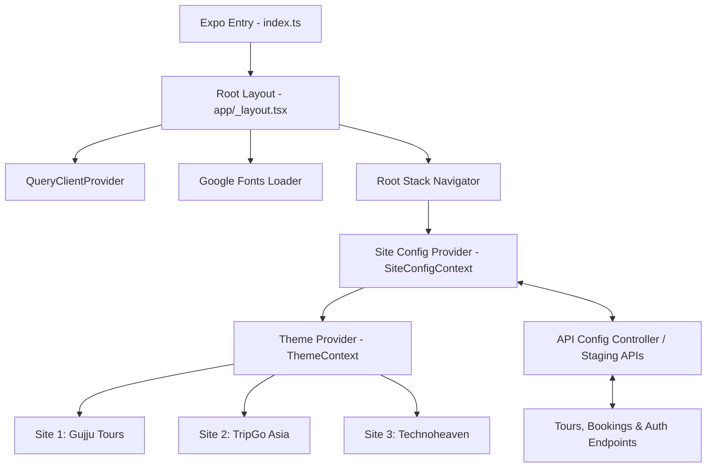

# 🌍 Multi-Brand Tours Mobile Application (`my-app`)

A high-performance, native multi-brand mobile application built with **Expo SDK 57**, **React Native 0.86**, **React 19**, and **TypeScript**. 

One single codebase powers **3 distinct travel brands**, dynamically adapting colors, typography, logos, layouts, and tour offerings at runtime based on backend configuration.

---

## 📑 Table of Contents
1. [Overview & Architecture](#-overview--architecture)
2. [Supported Brands](#-supported-brands)
3. [Choosing the Website and API](#-choosing-the-website-and-api)
4. [Key Features](#-key-features)
5. [Project Structure](#-project-structure)
6. [How Dynamic Configuration Works](#-how-dynamic-configuration-works)
7. [API & Networking Architecture](#-api--networking-architecture)
8. [Getting Started & Running Locally](#-getting-started--running-locally)
9. [Available Scripts](#-available-scripts)
10. [Troubleshooting & Gotchas](#-troubleshooting--gotchas)

---

## 🏛 Overview & Architecture

Unlike traditional single-tenant apps, `my-app` is designed as a **dynamic multi-tenant client** ported from a Next.js multi-website platform to native iOS/Android.



### Technology Stack
- **Framework**: [Expo SDK 57](https://expo.dev) with [Expo Router](https://docs.expo.dev/router/introduction/) (file-based routing)
- **Engine**: [React Native 0.86](https://reactnative.dev) + Hermes Engine
- **Language**: TypeScript 5.8 (Strict Mode, zero `any`)
- **Data & State**: [@tanstack/react-query v5](https://tanstack.com/query/latest) + React Context
- **Animation & Gestures**: `react-native-reanimated v4`, `react-native-worklets`, `react-native-gesture-handler`
- **Offline & Storage**: `@react-native-async-storage/async-storage`, `expo-secure-store`, `@react-native-community/netinfo`
- **Images & Icons**: `expo-image` (blurhash, CDN caching), `@expo/vector-icons`

---

## 🏷 Supported Brands

The app currently serves 3 distinct travel brands out of the box:

| Brand Identifier | Brand Name | Hostname | Staging API Base | Theme Color | Target Audience |
| :--- | :--- | :--- | :--- | :--- | :--- |
| **`gujjutours`** (`website1`) | **Gujju Tours** | `www.gujjutours.com` | `https://stagingapi.gujjutours.com` | `#2563EB` (Royal Blue) | Family vacations & cultural excursions |
| **`tripgoasia`** (`website2`) | **TripGo Asia** | `www.tripgoasia.com` | `https://stagingapi.tripgoasia.com` | `#16A34A` (Emerald Green) | Trekking, adventure & wildlife |
| **`technoheaven`** (`website3`) | **Technoheaven** | `stagingb2b.technoheaven.com` | `https://stagingapi.technoheaven.com` | `#DC2626` (Crimson Red) | Luxury escapes, resorts & beach getaways |

---

## ⚙️ Choosing the Website and API

The active website and API are strictly controlled by environment configuration (`src/config/env.ts`) and the unified launcher (`scripts/start.js`).

### Environment Variables Reference

All runtime variables are placed inside **`my-app/.env`**:

| Variable | Description | Example Values | Required |
| :--- | :--- | :--- | :--- |
| **`EXPO_PUBLIC_SITE_ID`** | The active website tenant ID | `gujjutours`, `tripgoasia`, `technoheaven` | **Yes** |
| **`EXPO_PUBLIC_SITE_HOSTNAME`** | The canonical hostname sent in `X-Website-Hostname` and config URL | `www.gujjutours.com`, `www.tripgoasia.com`, `stagingb2b.technoheaven.com` | **Yes** |
| **`EXPO_PUBLIC_CONFIG_API_URL`** | Base URL for the `/api/core/v1/config/{hostname}` endpoint | `https://stagingapi.gujjutours.com`, `https://stagingapi.tripgoasia.com` | **Yes** |
| **`EXPO_PUBLIC_API_URL`** | Base URL for all tour listings, bookings, and auth endpoints | `https://stagingapi.gujjutours.com` or `http://10.187.x.x:5000` (LAN backend) | **Yes** |
| **`EXPO_PUBLIC_DEFAULT_LANG`** | Default language code for API queries | `en` (default), `ar`, `es` | No |
| **`EXPO_PUBLIC_USE_LOCAL_BACKEND`** | Enables connection to local ASP.NET Core backend on port 5000 | `false` (default) or `true` | No |
| **`EXPO_PUBLIC_ENABLE_SITE_SWITCHER`** | Enables runtime modal site switching during development | `false` (default) or `true` | No |

### Configuration File Priority Order

When starting the application, settings are resolved using strict precedence:

1. **CLI Flag (`--site=<brand>`)** *(Highest Priority)*:
   - Example: `npm start -- --site=tripgoasia`
   - Completely overrides all `.env` and `.env.local` files and sets all site parameters consistently.
2. **`.env.local`** *(High Priority)*:
   - Local overrides (e.g., `REACT_NATIVE_PACKAGER_HOSTNAME` or developer-specific keys).
   - If `.env.local` overrides any site variables from `.env`, the launcher displays a prominent console warning.
3. **`.env`** *(Standard Priority)*:
   - The primary file checked into the workspace specifying the team's active site configuration.
4. **Built-in Defaults (`gujjutours`)** *(Lowest Priority)*:
   - Used only if variables are omitted from all files.

### Site Consistency Validation

To prevent subtle bugs where a site ID points to Gujju Tours but the hostname or API points to TripGo Asia:
- **Strict Validation**: On boot, `src/config/env.ts` verifies that `EXPO_PUBLIC_SITE_ID`, `EXPO_PUBLIC_SITE_HOSTNAME`, and `EXPO_PUBLIC_CONFIG_API_URL` match the same website tenant.
- **Mismatch Error Screen**: If variables conflict, the app displays a full-screen error naming the conflicting variables and showing their expected values.
- **Tenant Cache Invalidation**: On startup, the app compares the active site ID and API URL against the last stored values. If the site changed, the app automatically flushes the React Query cache and clears stale AsyncStorage keys for configs, queries, bookings, wishlist, and auth tokens.

### Checklist to Switch Sites

#### Option A: One Command via CLI Flag (Fastest & Safest)
To test a different brand without altering any `.env` files:
```bash
# Launch Gujju Tours:
npm start -- --site=gujjutours

# Launch TripGo Asia:
npm start -- --site=tripgoasia

# Launch Technoheaven:
npm start -- --site=technoheaven
```
The launcher sets all variables, clears Metro's bundler cache (`-c`), and prints the resolved site.

#### Option B: Updating `my-app/.env`
1. Open `my-app/.env`.
2. Update the variables to your target site:
   ```env
   # Example: TripGo Asia
   EXPO_PUBLIC_SITE_ID=tripgoasia
   EXPO_PUBLIC_SITE_HOSTNAME=www.tripgoasia.com
   EXPO_PUBLIC_CONFIG_API_URL=https://stagingapi.tripgoasia.com
   EXPO_PUBLIC_API_URL=https://stagingapi.tripgoasia.com
   EXPO_PUBLIC_DEFAULT_LANG=en
   EXPO_PUBLIC_USE_LOCAL_BACKEND=false
   ```
3. Run `npm start`.
4. Check the terminal banner to confirm:
   ```text
   ✓ Active Site:      TripGo Asia (tripgoasia)
   ✓ Site Hostname:    www.tripgoasia.com
   ✓ Resolved From:    .env
   ```
5. Scan the QR code in Expo Go. The bottom developer pill confirms `[DEV] tripgoasia (.env)`.

---

## ✨ Key Features

1. **Strict Single Source of Truth**:
   - Environment variables dictate the active website identity. Runtime site switcher persistence cannot silently override `.env`.

2. **Config-Driven Dynamic Layouts**:
   - Dynamic theme overrides: primary colors, button radius, font families, and card styles update automatically from the backend API.

3. **Offline-Resilient Architecture**:
   - Network connectivity listener (`@react-native-community/netinfo`).
   - Automatically caches tour listings, site configs, and bookings locally in `AsyncStorage`.
   - Displays offline indicators and serves cached content when offline.

4. **Multi-Tenant API Scoping**:
   - Every tour request, booking, and search automatically includes multi-tenant headers:
     - `X-Website-Hostname`: e.g. `www.gujjutours.com`
     - `X-Website-Id`: e.g. `gujjutours`
   - The backend scopes all data queries specifically to the active brand.

5. **Cross-Platform Compatibility**:
   - Runs in **Expo Go on physical Android/iOS devices**.
   - Runs in desktop browsers via **Expo Web** (`Platform.OS === 'web'`).

---

## 📁 Project Structure

```text
my-app/
├── app/                          # Expo Router file-based screens
│   ├── (admin)/                  # Admin management screens
│   ├── (auth)/                   # Authentication screens
│   ├── (tabs)/                   # Main tab navigation (Home, Explore, Bookings, Wishlist, Profile)
│   ├── _layout.tsx               # Root layout (Fonts, Splash, Providers, Error Guards)
│   ├── index.tsx                 # Root redirection
│   └── site-switcher.tsx         # Modal brand switcher screen
├── components/                   # Reusable UI components
│   ├── DevBanner.tsx             # Non-intrusive bottom diagnostic widget with provenance
│   ├── EnvErrorScreen.tsx        # Full-screen configuration error & mismatch guard
│   ├── TourCard.tsx              # Brand-adaptive tour card
│   └── ...
├── constants/                    # Tokens and registry
│   ├── siteRegistry.ts           # Site constants and registry mapping
│   └── theme.ts                  # Design tokens (Spacing, Radius, Shadows)
├── hooks/                        # Custom React hooks
│   ├── useSelectedSite.ts        # Site identity hook driven by ENV
│   ├── useTours.ts               # Tours query hook with caching
│   └── useNetworkStatus.ts       # Network online/offline listener
├── services/                     # Unified networking layer
│   └── api.ts                    # Single API client with multi-tenant headers
├── src/config/                   # Central configuration
│   ├── env.ts                    # THE single runtime process.env reader and validator
│   ├── sites.ts                  # Allowed site definitions and hostname resolver
│   └── websites.ts               # Multi-website metadata
├── scripts/                      # Developer and launcher automation
│   ├── start.js                  # Unified cross-platform CLI launcher
│   ├── doctor.js                 # System health and connectivity diagnostics
│   └── check-api.js              # Direct HTTP API reachability checker
├── app.config.ts                 # Dynamic Expo app configuration
└── package.json                  # Dependencies & scripts
```

---

## 🌐 API & Networking Architecture

All API calls flow through `services/api.ts`:

- **Centralized Endpoint Resolution**:
  - Config endpoint routes to `ENV.configApiUrl/api/core/v1/config/{hostname}?lang={lang}`.
  - Data endpoints (tours, bookings, auth) route to `ENV.apiUrl`.
- **Multi-Tenant Headers**:
  - `X-Website-Hostname`: automatically attached to every request.
  - `X-Website-Id`: active brand identifier.
- **Resilience**:
  - 15-second `AbortController` timeout on all network requests.
  - Exponential backoff retries for read operations.
  - Automatic `AsyncStorage` caching when the device is offline.
- **Authentication**:
  - Securely reads auth tokens from `expo-secure-store` with `AsyncStorage` fallback.

---

## 🚀 Run the app

You can start the entire app with **ONE command**:

```bash
npm start
```

No manual cache clearing or separate commands required!

### Available Startup Flags

Pass flags to `npm start` by appending `--` followed by the flag:

```bash
# 1. Switch active website without editing any .env files:
npm start -- --site=gujjutours      # Gujju Tours (www.gujjutours.com)
npm start -- --site=tripgoasia      # TripGo Asia (www.tripgoasia.com)
npm start -- --site=technoheaven    # Technoheaven (stagingb2b.technoheaven.com)

# 2. Connection modes:
npm start                          # LAN mode (default: auto-detects real Wi-Fi IP)
npm start -- --tunnel              # Tunnel mode (cloud proxy via @expo/ngrok)

# 3. Target platforms:
npm start -- --web                 # Desktop browser preview
npm start -- --android             # Connect Android emulator / USB device
npm start -- --ios                 # Connect iOS simulator / device

# 4. Optional local ASP.NET Core backend:
npm start -- --backend             # Starts dotnet run in backend folder & connects app
```

### Convenient NPM Shortcut Scripts

| Command | Action |
| :--- | :--- |
| `npm start` | One-command startup (validates env, checks API, cleans cache, detects LAN IP) |
| `npm run start:gujjutours` | Quick launch with Gujju Tours (`--site=gujjutours`) |
| `npm run start:tripgoasia` | Quick launch with TripGo Asia (`--site=tripgoasia`) |
| `npm run start:technoheaven` | Quick launch with Technoheaven (`--site=technoheaven`) |
| `npm run doctor` | Run full environment, API, port, and network diagnostic checks |
| `npm run check:api` | Test reachability & response times of all staging and local API endpoints |
| `npm run tunnel` | Launch directly in Ngrok tunnel mode |
| `npm run web` | Launch in web browser |
| `npm run android` | Launch targeting Android |

---

## 🛠 Troubleshooting & Gotchas

### 1. App shows "Site Configuration Mismatch" on screen
- **Cause**: Variables in `my-app/.env` point to different sites (for example `EXPO_PUBLIC_SITE_ID=gujjutours` but `EXPO_PUBLIC_SITE_HOSTNAME=www.tripgoasia.com`).
- **Fix**: Run `npm start -- --site=gujjutours` to automatically align all variables, or update `.env` to match the same website.

### 2. "remote gone away" (Ngrok Tunnel)
- **Cause**: Metro was stopped and restarted within 2 seconds before Ngrok's edge server closed the previous session.
- **Fix**: Wait 15–20 seconds before restarting `npx expo start --tunnel`.

### 3. Phone cannot connect in LAN mode (`10.187.x.x`)
- **Cause**: Using a mobile hotspot (Android kernel blocks hotspot clients from communicating with the host phone) or Windows Firewall is blocking incoming connections.
- **Fix**: Use `npm run tunnel` mode, or connect both devices to a standard Wi-Fi router.

---

*Multi-Brand Tours App — Built with ❤️ using Expo, React Native, and TypeScript.*
